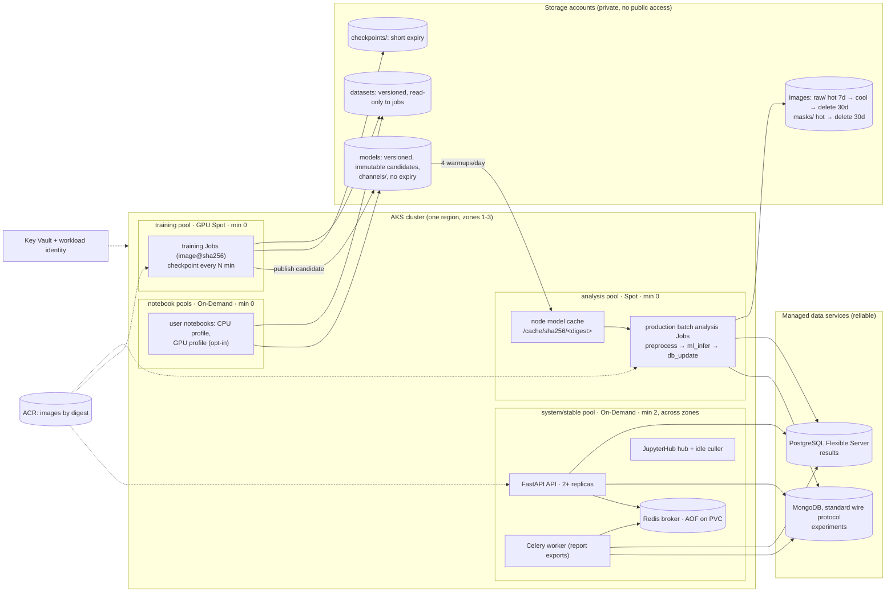

# Architecture and decisions

[Assignment](../../README.md) · [Model handoff design](../support-teams/DESIGN.md) · [Cloud task](README.md)

This file holds the cloud deployment plan (placement, capacity classes, the two worksheet calculations, migration) and the decision log. **Nothing here was deployed.** All dollar figures use the worksheet's **hypothetical exercise rates**. They are not provider quotes.

## 1. Cloud placement

Provider: **Azure**, because the system runs there today. Everything above the node pools and storage accounts stays provider-neutral (§5). The diagram extends the [notebook-to-model workflow](../support-teams/DESIGN.md#workflow): the model registry there is the `models` container here.

| Component | Runs on | Capacity class | Scales to zero? |
|---|---|---|---|
| API (FastAPI) | AKS stable pool, ≥2 replicas spread over zones, HPA | Reliable On-Demand | No. It is user-facing and a cold start would surface as latency. |
| Celery worker + Redis broker | Stable pool. Redis in-cluster with AOF on a zone-redundant disk | Reliable On-Demand | Worker: possible with KEDA on queue length. It is small, so it stays at 1. Redis: no. |
| Production batch analysis | Kubernetes Jobs on a Spot CPU pool. An On-Demand fallback pool (min 0) has a lower scheduling priority | **Spot** | Yes |
| Notebook users | JupyterHub. The hub runs on the stable pool, user pods on CPU/GPU notebook pools. Home directories on PVCs | On-Demand (interactive state is lost on eviction) | Yes. Idle culling plus autoscaler |
| Training workers | Kubernetes Jobs on a GPU Spot pool. On-Demand GPU pool (min 0) for deadline/final runs | **Spot** with checkpoints | Yes |
| PostgreSQL | Azure Database for PostgreSQL Flexible Server, PITR backups | Reliable (managed) | No |
| MongoDB | MongoDB Atlas on Azure (default) or self-managed replica set. Standard driver only, no Cosmos DB APIs | Reliable (managed) | No |
| Raw images, masks | `images` storage account, lifecycle rules ([Terraform task](../cloud-infrastructure/README.md)) | n/a | n/a |
| Datasets | `datasets` container, `datasets/<name>/<version>/`, read-only to jobs | n/a | n/a |
| Model artifacts | `models` container: versioning, write-once candidates, no lifecycle deletion | n/a | n/a |

## 2. Reliable vs. interruptible capacity

- **Reliable:** API, Redis broker, the JupyterHub hub, both databases. They hold state or answer users. Interrupting them causes an outage, not a delay. The stable pool is kept small. It is the only compute that bills 24/7.
- **Spot, scale to zero:** production batch analysis. Each step is restartable. `db_update` upserts on `(experiment_id, image_id)`, so a retried shard does not duplicate rows. A Spot eviction costs re-running the shard, and the 20% retry overhead in §3.2 accounts for that. If Spot capacity is unavailable for longer than the analysis deadline allows, pending pods fall through to the On-Demand pool (lower-priority node pool / cluster autoscaler expander). The output is the same, only the cost changes.
- **Spot, scale to zero, with checkpoints:** training. It is long-running but resumable (§6).
- **On-Demand but scale to zero:** notebooks. A Spot eviction kills a kernel and in-memory state, and a user loses work. They should not have to design around that. Culling and min-0 pools give most of the savings without the eviction risk.

## 3. Calculations

Units: 1 GiB = 1,024 MiB, month = 30 days. Rates are the worksheet's hypothetical values.

### 3.1 Storage policy

Daily ingest:

| Item | Formula | GiB/day |
|---|---|---|
| Raw images | 500,000 × 10 MiB ÷ 1,024 | **4,882.8125** |
| Masks | 500,000 × 1 MiB ÷ 1,024 | **488.28125** |
| Total | | 5,371.09375 |

Steady state after retention has filled (capacity = GiB/day × days retained, then × monthly rate):

| Policy | Tier | Capacity (GiB) | Rate ($/GiB-month) | $/month |
|---|---|---|---|---|
| **Baseline** | raw hot, 4,882.8125 × 30 | 146,484.375 | 0.02 | 2,929.69 |
| | masks hot, 488.28125 × 30 | 14,648.4375 | 0.02 | 292.97 |
| | **total** | **161,132.81** | | **3,222.66** |
| **Alternative** | raw hot, 4,882.8125 × 7 | 34,179.6875 | 0.02 | 683.59 |
| | raw cool, 4,882.8125 × 23 | 112,304.6875 | 0.01 | 1,123.05 |
| | masks hot, 488.28125 × 30 | 14,648.4375 | 0.02 | 292.97 |
| | **total** | **161,132.81** (48,828.13 hot + 112,304.69 cool) | | **2,099.61** |

**Difference: $3,222.66 − $2,099.61 = $1,123.05/month (34.8% lower).** Stored volume is the same. Only the 23 cool days of raw images change price: 112,304.6875 GiB × ($0.02 − $0.01).

**Provider caveat (lifecycle timing).** On Azure, the cool tier has a **30-day minimum storage duration**. The raw images spend only 23 days in cool, so each blob is billed an early-deletion charge for the 7 remaining days. With worksheet rates that is 4,882.8125 GiB/day × 30 cohorts × $0.01 × 7/30 = **$341.80/month**. The alternative then costs **~$2,441.41**, which saves **~$781.25/month (24.2%)** instead of $1,123.05. It is still cheaper, because 30 days of cool ($0.30/GiB) cost less than 23 extra hot days ($0.46/GiB). GCP Nearline also has a 30-day minimum. AWS S3 can't transition objects to Standard-IA before day 30, so this exact policy can't be built on AWS. Lifecycle rules also run about once a day. Objects can stay in a tier up to a day longer than configured, so the steady-state figures are a slight underestimate.

**Retrieval/retention trade-off.** Raw images older than 7 days are cheaper to keep but more expensive to read: cool tier adds a per-GiB retrieval charge and higher per-operation read prices. One example: Data/ML or Dev re-processes last week's images with a newly promoted model. That reads up to 4,882.8 GiB per day of history from cool. If re-analysis beyond 7 days becomes routine, the saving shrinks or reverses. Masks stay hot because they are 10× smaller and more likely to be re-read for QA. Deletion at day 30 is permanent: anything that must outlive it, such as a training dataset, must be **copied** to `datasets/` with a version first.

**Recommendation:** use the alternative policy. It saves money even after the 30-day minimum charge. Track cool-tier read volume, and revisit the 7-day boundary if reprocessing becomes routine.

### 3.2 Production analysis compute and model delivery

| | Formula | Node-hours/month | $/month |
|---|---|---|---|
| On-Demand | 100 node-h/day × 30 × $0.20 | 3,000 | **600.00** |
| Spot | 100 × 1.20 retry overhead × 30 × $0.06 | 3,600 | **216.00** |
| Difference | | | **$384.00/month (64% lower)** |

Spot stays cheaper until the retry overhead reaches $0.20 ÷ $0.06 − 1 = **233%**, so it is robust against much worse eviction rates than the 20% assumed. If capacity shortages pushed 25% of the work to the On-Demand fallback, the cost would be 0.75 × $216 + 0.25 × $600 = **$312/month**. That is still about half of On-Demand.

Model transfer (1.5 GiB production model):

| | Formula | GiB/day | GiB/month |
|---|---|---|---|
| No cache | 2,000 downloads × 1.5 GiB | **3,000** | 90,000 |
| Cache | 4 warmups × 1.5 GiB | **6** | 180 |
| Reduction | | 2,994 (99.8%) | |

**Startup benefit.** Without a cache, every analysis pod blocks on a 1.5 GiB download before work starts. *Illustrative only:* at an assumed 100 MiB/s per node, that is ~15 s per start. Across 2,000 starts it is ~8.5 node-hours/day of paid idle time, about 8.5% of the workload. 2,000 nodes pulling at once can also hit storage-account throughput limits. With a warm cache, start-up is a local SHA-256 check.

**Cache design and loss on interruption.** The cache is node-local and content-addressed: `/cache/sha256/<digest>`. It is filled by a DaemonSet or init step that downloads to a temp file, verifies the digest from `channels/production.json`, then renames atomically. An incomplete file is never used. A promotion changes the digest, so it gets a new key; old keys are removed by LRU. A Spot eviction **destroys the node's cache**. The replacement node pays one more 1.5 GiB warmup and the start delay. The worksheet's "4 warmups/day" therefore really means "4 + one per node replacement". Even at 50 evictions/day that is 81 GiB/day, still ~97% below the no-cache case. If evictions get frequent, a zone-local shared cache (a small On-Demand cache node or a ReadOnlyMany volume) survives Spot loss, at the cost of one more component to run.

**Where network charges could apply** (no transfer price is supplied, so none is priced):
- Storage read operations and, if the model ever sits in cool, retrieval per GiB. Keep `models/` hot.
- Cross-region reads, if the cluster and the storage account are not co-located.
- Cross-zone traffic, depending on the provider's inter-AZ policy.
- Private endpoint / NAT gateway per-GiB processing, when nodes reach storage through them.
- Internet egress: only for exports or a provider migration (§5).
- Container image pulls from ACR (same issue as model pulls, which is why images stay small and models stay out of them).

**Recommendation:** run production analysis on Spot with an On-Demand fallback, and always run it with the node-local model cache. Spot saves ~$384/month. The cache removes ~99.8% of model transfer and most of the start-up delay. Spot eviction makes the cache more important, not less.

### 3.3 Omitted costs and risks

Not in the numbers above:
- Storage write/list/delete operations: ~1M object writes/day plus lifecycle tier-change operations. Retrieval charges. Egress.
- AKS control plane (Standard tier for the uptime SLA), load balancer, public IPs, NAT, private endpoints.
- The always-on stable pool. Database compute, storage and IOPS. High availability (zone-redundant HA roughly doubles database compute). Backups and point-in-time-restore retention.
- Log/metric ingestion (Azure Monitor/Log Analytics can be a large line item). Key Vault and ACR.
- Spot risks: regional Spot shortages (the fallback costs On-Demand prices), evictions near an analysis deadline, and the 20% overhead being an assumption, not a measurement.
- GPU quota: approval often blocks a new region or provider for days.

## 4. Training, GPUs and notebooks (no extra calculation)

- **GPU utilization.** An idle or starved GPU costs the same as a busy one. Measure it with the DCGM exporter. Low utilization usually means input bottlenecks: stage the dataset version to local NVMe, raise data-loader workers, and right-size CPU and RAM next to the GPU. Use one training pod per GPU node. Keep the autoscaler scale-down delay short (~10 min) so a finished job doesn't leave a node billing. Small experiments and GPU notebooks can share GPUs (MIG or time-slicing) instead of each holding a full card.
- **Idle notebooks.** A GPU notebook left open overnight bills ~16 GPU-hours for nothing. JupyterHub's idle culler stops servers after inactivity: about 30 min on the GPU profile and 2 h on CPU, plus a max server age. The notebook pools then scale back to 0. Home directories are PVCs, so culling loses only kernel state, not files. GPU is an explicit opt-in profile, never the default.
- **Interrupted training and checkpoints.** One Spot eviction costs the work since the last checkpoint, plus restart overhead: rescheduling, image pull, dataset staging, warm-up. Eviction notices are short: about 30 s on Azure and GCP, 2 min on AWS. So checkpoints must be **periodic**; a SIGTERM handler only helps sometimes. Checkpoints that are too frequent waste GPU time on I/O and storage. Too rare, and every eviction repeats a lot of work. Pick the interval from the measured checkpoint time and eviction rate. Checkpoints go to `checkpoints/<run-id>/` with a short expiry and only the last N kept. They are never in `models/`: a preempted job publishes nothing, because publication is a separate atomic step ([design](../support-teams/DESIGN.md#training-environment-notes)). A Job with `backoffLimit` resumes from the latest checkpoint. Deadline or final runs can go to the On-Demand GPU pool.

## 5. Migration outline (analysis, training, storage)

What makes it portable: containers referenced by digest. Every location comes from config (`POSTGRES_URL`, `MONGO_URL`, `CELERY_BROKER_URL`, `MODEL_REGISTRY_DIR`, `MODEL_SELECTION_FILE`). Artifacts and metadata are open formats (JSON handoff, SHA-256). Data access is plain files, materialised by a mount or sync at the edge. Business logic has no Azure Storage SDK, no Event Grid trigger, no Azure ML and no Cosmos DB-specific API.

| Step | Analysis | Training | Storage |
|---|---|---|---|
| **Config & credentials** | New overlay (Kustomize/Helm values): Spot node selector/toleration, StorageClass, DB/broker URLs. Secrets come from the new secret store through the CSI driver | Same image digest pushed to the new registry. Same Job spec except node pool labels, GPU tolerations and the identity annotation | New Terraform module (bucket, versioning, immutability, lifecycle). Workload identity / OIDC federation replaces Azure workload identity. CI switches to OIDC for the new provider |
| **Data transfer** | None for raw images: **dual-write** new ingest to the new provider and let the old copy age out at day 30. That avoids ~157 TiB of egress. PostgreSQL: logical replication (or dump/restore in a freeze window). MongoDB: Atlas moves between clouds itself; self-managed uses `mongodump`/`mongorestore` | Copy the needed `datasets/<name>/<version>/` with a SHA-256 manifest. In-flight runs either finish on the old side or restart from a copied checkpoint | `models/` (small, immutable): copy candidates, gate records and channels. Checkpoints: don't migrate |
| **Verification** | Run the fixture experiment end to end against the new stack (`verify-experiment.sh` checks: 5 results, COMPLETED, model digest, timing). Shadow-run a real batch on both sides and compare `image_metrics`. Compare row counts per experiment | Retrain the toy model in the new pool. The gate re-scores it, and the digest and `test_mse` must match. Check `environment.json` | Compare **our own** SHA-256 manifest, not provider MD5/ETag: those differ for multipart uploads. `model_handoff resolve` must return the same digest from the new location |
| **Rollback** | Point the config back. The old cluster stays scaled to 0 but defined during the window. Rows written on the new side must be replicated back or re-run (idempotent upserts make re-running safe) | Run on the old pool again; images and datasets are unchanged there | Both copies are immutable and the old one stays readable. Switch `MODEL_REGISTRY_DIR`/`MODEL_SELECTION_FILE` back. Dual-write keeps image history complete on both sides until cutover is final |

**Remaining provider coupling (acknowledged):**
- Terraform modules and lifecycle semantics. One example: AWS can't do the 7-day cool transition (§3.1).
- Node pool definitions and Spot labels/taints: `kubernetes.azure.com/scalesetpriority=spot`, `eks.amazonaws.com/capacityType=SPOT`, `cloud.google.com/gke-spot=true`.
- Identity bindings, StorageClass and CSI driver names.
- Managed DB TLS/connection settings.
- The mount/sync tool at the edge (blob CSI, Mountpoint for S3, GCS FUSE, or `rclone`, which works on all three).

None of these is in Python code. Without the optional storage task, the interface stays open because code only sees a directory and a digest. Moving to S3-compatible access later (MinIO locally) would replace the mount/sync edge, not the business logic.

**Likely operational work:**
- GPU and Spot quota requests (start first; often the slowest step).
- Network design: private endpoints and DNS.
- IAM roles per job, the promotion approval environment, and the CI OIDC trust.
- Rebuilding dashboards, alerts and budgets.
- Database backup/PITR policies and a restore drill.
- Updated runbooks, and a 30-day dual-run period with double storage cost.

## 6. Decision log (cloud)

**Kubernetes (AKS) for API, analysis, notebooks and training.** One scheduler handles stable, Spot and GPU pools that scale to zero. The same Job/Deployment specs move to EKS/GKE with only node-pool and identity changes. *Alternative:* serverless containers (Azure Container Apps / Batch) per workload. *Trade-off:* less cluster operation work, but each service has its own job model and Spot support, so portability drops and the platform must be learned three times.

**Spot for production analysis, with an On-Demand fallback.** It saves 64% ($384/month at worksheet rates) and stays cheaper up to 233% retry overhead. The steps are idempotent. *Alternative:* all On-Demand. *Trade-off:* predictable completion times, at 2.8× the compute cost. The fallback pool gets most of that predictability back when Spot is scarce.

**Alternative storage policy (raw cool after 7 days).** It saves $1,123/month at the worksheet's rates. That is ~$781/month after Azure's 30-day cool minimum. *Alternative:* all hot for 30 days. *Trade-off:* simpler and with cheap re-reads, but costs more. Cool is the wrong choice if raw images older than 7 days are re-analysed often.

**Node-local, digest-keyed model cache.** It cuts model transfer from 3,000 to 6 GiB/day and removes download time from pod start. *Alternative:* bake the model into the image. *Trade-off:* the start-up would be equally fast, but every model promotion would need an image rebuild. That breaks the "change models by configuration" handoff and puts weights in the registry.

**MongoDB via the standard wire protocol (Atlas or self-managed), not Cosmos DB-specific features.** Atlas runs on all three clouds, so a migration doesn't touch the experiment store. *Alternative:* Azure Cosmos DB for MongoDB. *Trade-off:* Azure-native billing and identity, but compatibility gaps and a provider-specific migration.

**On-Demand notebooks with idle culling, instead of Spot.** An eviction destroys an interactive session. Culling plus min-0 pools gets most of the savings. *Trade-off:* notebook hours cost On-Demand prices, so the culler timeouts are the main cost control.
