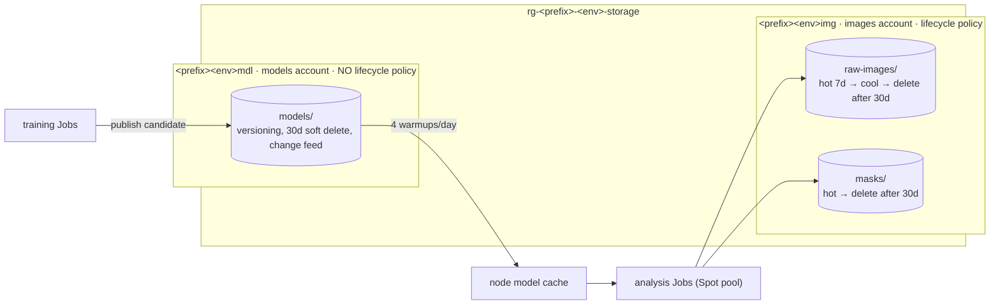

# Implement storage with Terraform — evidence

[Assignment](../../README.md) · [Task](README.md) · [Cloud architecture](../cloud-deployment/ARCHITECTURE_AND_DECISIONS.md) · [Terraform code](../../infra/)

Azure storage for raw images, masks and model artifacts, in [`infra/`](../../infra/). **Nothing was deployed.** No `plan` or `apply` ran against Azure, and no Azure credentials were used. All dollar figures use the worksheet's **hypothetical rates**.

## What was built



This is the storage part of the [cloud diagram](../cloud-deployment/ARCHITECTURE_AND_DECISIONS.md#1-cloud-placement). `datasets/` and `checkpoints/` appear in that diagram but are **not implemented** here. The task covers images, masks and models only.

| File | Contents |
|---|---|
| `versions.tf` | Terraform `>= 1.9, < 2.0`, `hashicorp/azurerm ~> 4.0`. No backend block |
| `providers.tf` | No credentials. Entra ID for storage calls, no data-plane calls during plan/apply |
| `variables.tf` | Names, region, redundancy, retention days, soft delete, network access. All validated |
| `main.tf` | Resource group, two storage accounts, three private containers |
| `lifecycle.tf` | The images account's lifecycle policy (2 rules) |
| `outputs.tf` | Account names/IDs, container URLs, effective retention |
| `terraform.tfvars.example` | Example inputs, no credentials |
| `tests/storage.tftest.hcl` | `terraform test` with a mocked provider (no Azure account) |
| `.terraform.lock.hcl` | azurerm 4.81.0, hashes for linux/windows/darwin, amd64/arm64 |

### Storage resources and lifecycle rules

| Data | Account | Container | Lifecycle rule (days since **creation**) | Protection |
|---|---|---|---|---|
| Raw images | `<prefix><env>img<suffix>` | `raw-images` | `raw-images-hot-cool-delete`: cool when age > 7, delete when age > 30 | None by default (`images_soft_delete_days = 0`) |
| Masks | same | `masks` | `masks-hot-delete`: delete when age > 30. Never tiered | Same |
| Model artifacts | `<prefix><env>mdl<suffix>` | `models` | **None.** The account has no lifecycle policy | Versioning, 30-day blob and container soft delete, change feed |

**Why models get a separate account and not just a prefix.** An Azure lifecycle (management) policy belongs to the whole account. If models shared the images account, one wrong `prefix_match` (for example `""` or a typo) would expire production models. With a separate account, no image rule can reach a model blob. `terraform test` checks that the only lifecycle policy is attached to the images account. The second account costs nothing extra: Standard accounts bill for usage, not per account.

**Why creation time and not modification time.** The worksheet counts from ingest. `daysAfterCreationGreaterThan` doesn't restart when someone rewrites metadata or a tag.

### Private access

Both accounts:
- `allow_nested_items_to_be_public = false`: no anonymous container or blob access. All containers are `private`.
- `shared_access_key_enabled = false`: account keys and key-signed SAS tokens are rejected. Access is Entra ID + RBAC only.
- `public_network_access_enabled = false` by default: reachable only through private endpoints. The firewall is default-deny even when the public endpoint is enabled; only `allowed_subnet_ids` / `allowed_ip_ranges` get in.
- HTTPS only, TLS 1.2 minimum, no cross-tenant object replication.

Containers are created through Azure Resource Manager (azurerm 4.x `storage_account_id`), and `features.storage.data_plane_available = false`. So a CI runner outside the VNet can still apply, without opening the accounts to it.

## Commands and output

Terraform is not installed on this Windows machine, so the commands ran in the official image `hashicorp/terraform:1.17.2` (the same version CI pins), from `infra/`:

```bash
TF="docker run --rm -v $PWD:/infra -w /infra hashicorp/terraform:1.17.2"   # or a local terraform 1.17.2
$TF fmt -check -recursive
$TF init -backend=false -input=false -lockfile=readonly
$TF validate
$TF test
```

Output (`-no-color`, `.terraform/` deleted first):

```text
$ terraform fmt -check -recursive
[exit 0]
$ terraform init -backend=false -input=false -lockfile=readonly
Initializing provider plugins...
- Reusing version 4.81.0 of hashicorp/azurerm from the dependency lock file
- Installing hashicorp/azurerm v4.81.0...
- Installed hashicorp/azurerm v4.81.0 (signed by HashiCorp)

Terraform has been successfully initialized!
...
[exit 0]
$ terraform validate
Success! The configuration is valid.

[exit 0]
$ terraform test
tests/storage.tftest.hcl... in progress
  run "worksheet_policy_and_private_accounts"... pass
  run "retention_is_configurable"... pass
  run "rejects_delete_before_cool"... pass
  run "rejects_invalid_account_prefix"... pass
tests/storage.tftest.hcl... tearing down
tests/storage.tftest.hcl... pass

Success! 4 passed, 0 failed.
[exit 0]
```

`init` needed internet access to `registry.terraform.io` and `releases.hashicorp.com`, and had it. No step was blocked.

**What this proves and what it doesn't.** `validate` checks syntax, types and the provider schema. `terraform test` replaces azurerm with `mock_provider`. It checks what Terraform *would request*: the 7/30/30 day values, which container each rule targets, that masks are never tiered, which account holds the policy, that models are versioned, the privacy flags, and that invalid inputs are rejected. Neither command checks Azure permissions, quotas, name availability, policy acceptance by Azure, or pricing.

### A failing check

To confirm the tests catch a real mistake, I pointed the masks rule at the models container (`this["masks"]` → `this["models"]` in `lifecycle.tf`), ran the test, then restored the file:

```text
  run "worksheet_policy_and_private_accounts"... fail
Error: Test assertion failed
  on tests/storage.tftest.hcl line 50, in run "worksheet_policy_and_private_accounts":
  50:     condition     = azurerm_storage_management_policy.images.rule[1].filters[0].prefix_match == toset(["masks/"])
    │ --- actual
    │ +++ expected
    │ -   "models/"
    │ +   "masks/"
Mask rule must target only the masks container.
Failure! 3 passed, 1 failed.
```

**Issue encountered.** In the first version of the test, `command = plan` could not compare resource IDs, because they are unknown until apply. Switching to a mocked `apply` then failed with `parsing "amwcqzr8": parsing the StorageAccount ID`: the mock invents random strings, and azurerm parses `storage_account_id`. The fix was `override_resource` blocks giving each account a distinct, well-formed ARM ID. Because the IDs differ, the "policy is on the images account" assertion can actually fail. With identical mock IDs it would always pass. Verified by the 4/4 pass above and the failing mutation.

### Example inputs

[`infra/terraform.tfvars.example`](../../infra/terraform.tfvars.example), checked against the variable validations with `terraform console -var-file=terraform.tfvars.example`:

```text
> local.account_names
{
  "images" = "tcytedevimg01"
  "models" = "tcytedevmdl01"
}
> var.retention
{
  "mask_delete_days" = 30
  "raw_delete_days" = 30
  "raw_hot_days" = 7
}
```

Outputs after a real apply (`terraform output`) would be `storage_locations = { raw_images = "https://tcytedevimg01.blob.core.windows.net/raw-images", masks = ".../masks", models = "https://tcytedevmdl01.blob.core.windows.net/models" }`, plus account names/IDs and the effective retention.

### CI

`.github/workflows/ci-core-dev.yml`, job `terraform`. It runs when `infra/**` or the workflow changes. It pins Terraform 1.17.2 and runs `fmt -check -recursive`, `init -backend=false -input=false -lockfile=readonly` (fails if the committed lock file doesn't match the constraints), `validate`, and `test`. It uses no credentials and no plan/apply.

## Retention: provider minimums and lifecycle timing

Worksheet rates: hot $0.02, cool $0.01 per GiB-month. Ingest: raw 4,882.8125 GiB/day, masks 488.28125 GiB/day. Full calculation: [ARCHITECTURE_AND_DECISIONS §3.1](../cloud-deployment/ARCHITECTURE_AND_DECISIONS.md#31-storage-policy).

| | Formula | $/month |
|---|---|---|
| Alternative policy as specified | 34,179.69 hot raw × 0.02 + 112,304.69 cool raw × 0.01 + 14,648.44 hot masks × 0.02 | **2,099.61** |
| + Azure cool **30-day minimum** | Raw images spend only 23 days in cool, so 7 days are billed as early deletion: 4,882.8125 × 30 × 0.01 × 7/30 | **+341.80** |
| = With the minimum | | **2,441.41** (baseline all-hot: 3,222.66) |
| Upper bound with daily evaluation lag | Lifecycle runs ~once a day: raw hot up to 8 d (39,062.5 GiB × 0.02 = 781.25), cool 23 d (1,123.05), masks up to 31 d (15,136.72 GiB × 0.02 = 302.73), + 341.80 | **≤ 2,548.83** |

- The early-deletion charge comes from Azure's cool minimum (30 days; cold is 90, archive 180). It is still cheaper than keeping raw images hot: 30 billed cool days cost $0.30/GiB, 23 more hot days cost $0.46/GiB.
- "Greater than 7" plus a once-a-day run means the tier change happens on day 8 at the latest. Deletion happens on day 31 at the latest. A **new or changed policy can take up to 24 h to start running**, so don't expect deletions right after `apply`.
- Moving each blob to cool is a write operation: ~500,000 tier changes/day. Operations are not in the worksheet, so they are not priced here.
- Soft delete on the images account is **off by default**. With it on, each lifecycle deletion stays billable for N more days: N × (4,882.8125 × 0.01 + 488.28125 × 0.02) = **N × $58.59/month**. It also means a deleted blob can be restored. The variable exists so that trade-off is a deliberate choice.
- Other providers: GCS can express this policy exactly (`SetStorageClass NEARLINE` at age 7, `Delete` at age 30; Nearline also has a 30-day minimum). AWS S3 can't move objects to Standard-IA before day 30, so the 7-day cool step would need a different class or a different policy.

## What expiration and cleanup delete

| Action | Deletes | Recoverable? |
|---|---|---|
| Lifecycle, `raw-images` | Every **block blob** in `raw-images` created > 30 days ago. That includes anything someone else put in that container | No, with soft delete off. Copy what must be kept (for example a training set) to a versioned `datasets/` location **before day 30** |
| Lifecycle, `masks` | Every block blob in `masks` created > 30 days ago | Same |
| Lifecycle, models | Nothing. No policy exists on the models account | — |
| Deleting a model blob/version by hand | That blob or version | Yes, for 30 days (soft delete + versioning) |
| `terraform destroy` | The resource group, **both accounts and all data in them, models included.** Blob soft delete doesn't cover account deletion | Only through a support/account-recovery request, which isn't guaranteed. Back up `models/` first |

Append and page blobs are not matched by the rules (`blob_types = ["blockBlob"]`). The pipeline writes only block blobs. azurerm 4.x by default refuses to delete a resource group that still has resources Terraform doesn't manage (for example a private endpoint added by hand), so `destroy` fails safely instead of deleting them.

## Deployment and cleanup (not run)

Requires an Azure subscription you are allowed to manage. From `infra/`:

```bash
az login                                    # or ARM_* env vars + ARM_USE_OIDC=true in CI
export ARM_SUBSCRIPTION_ID=<subscription-id>
cp terraform.tfvars.example terraform.tfvars  # git-ignored; set a unique name_prefix/name_suffix
# For a throwaway dev test without private endpoints, set in terraform.tfvars:
#   public_network_access_enabled = true
#   allowed_ip_ranges = ["<your egress IP>"]
terraform init                              # prod: add -backend-config=... (see below)
terraform plan -out=storage.tfplan          # *.tfplan is git-ignored
terraform apply storage.tfplan
terraform output storage_locations

# Cleanup: deletes both accounts and ALL data, including models.
terraform plan -destroy -out=destroy.tfplan
terraform apply destroy.tfplan
```

**Expected charges for a dev deployment:** no fixed monthly fee for the Standard GPv2 accounts, the containers or the lifecycle policy. Billing is per GiB stored and per operation. With the repository's fixture data (a few MiB) that rounds to cents. This module creates no private endpoints or other hourly-billed resources. At production volume, storage costs what the table above shows, plus operations and the model versions kept (small: 1.5 GiB per published model).

## External dependencies

Not created by this module:
- An **Azure subscription** with the `Microsoft.Storage` resource provider registered, and an identity that can create resource groups and storage accounts (Contributor on the subscription or a pre-created resource group).
- **Globally unique account names.** `name_prefix` + `environment` + `name_suffix`, 3-24 characters, `[a-z0-9]`.
- **Private networking** for the default `public_network_access_enabled = false`: VNet/subnet, private endpoints for `blob`, and the `privatelink.blob.core.windows.net` private DNS zone linked to the AKS VNet. Without them the data is unreachable. That is safe, but useless.
- **RBAC for workloads**: `Storage Blob Data Contributor` on the images account for ingest/analysis. `Storage Blob Data Reader` on `models` for analysis and the cache warmer. `Storage Blob Data Contributor` on `models` **only** for the publishing/promotion identity. These need the AKS workload-identity principals, so they are not here.
- **Remote state storage account** (production only, see below). It is bootstrapped separately; a state backend can't manage itself.
- Internet access to `registry.terraform.io` / `releases.hashicorp.com` for `init` (and Docker Hub, if using the container as above).

## Credentials, shared state and locking (production)

- **Credentials.** None in code, tfvars or state config. Locally: `az login`. CI: GitHub OIDC federated credential on an Entra app/managed identity (`ARM_USE_OIDC=true`, no client secret), scoped to this resource group. `plan` runs on PRs. `apply` runs only from `main` behind a protected environment with required reviewers. The accounts reject shared keys, so workloads use AKS workload identity, never connection strings.
- **Shared state.** An `azurerm` backend in a separate, private state storage account. It has versioning and soft delete (to recover a corrupted state), `use_azuread_auth = true`, and is reachable only by the CI identity and a break-glass group. It is supplied at init time: `terraform init -backend-config=backend.prod.hcl`. That file holds only resource names, no secrets. State is still sensitive: it can contain account key attributes, which Azure generates even when shared-key auth is disabled. That is why it isn't in Git.
- **Locking.** The azurerm backend takes a **blob lease** on the state file during plan/apply, so two runs can't write state at once. Add a CI `concurrency` group per environment so runs queue instead of failing on the lock. `force-unlock` only after confirming the holder is dead.

## How this keeps the design portable

The workloads never see Azure resource types. They get **three locations** (`raw_images`, `masks`, `models`) as a mount path or a URL in config: `MODEL_REGISTRY_DIR`, `MODEL_SELECTION_FILE`, and the pipeline's data directories. `model_handoff` reads and writes plain files and verifies SHA-256 digests. It doesn't use the Azure SDK, ETags or Event Grid.

| Portable concept (design) | Azure resource here | AWS / GCP equivalent |
|---|---|---|
| Bucket per data class | Storage account + container | S3 bucket / GCS bucket |
| Image retention | `azurerm_storage_management_policy` | S3 lifecycle configuration (no IA before day 30) / GCS lifecycle rules |
| Model immutability and rollback | Blob versioning + soft delete, separate account | S3 versioning (+ Object Lock) / GCS object versioning (+ retention policy) |
| Private, identity-only access | No anonymous access, shared keys off, private endpoint | Block Public Access + bucket policy + VPC endpoint / Uniform access + PAP + Private Service Connect |
| Interface to workloads | `storage_locations` output | Same output keys from the other provider's module |

Moving providers means writing a sibling module with the same variables (`retention`, names, region) and the same `storage_locations` output keys. The application config, the model channel files and the digests stay the same. Remaining coupling is in Terraform and the mount/sync edge, not in Python (see [§5](../cloud-deployment/ARCHITECTURE_AND_DECISIONS.md#5-migration-outline-analysis-training-storage)).

## Limits and honest gaps

- Not deployed, no `plan` against Azure. Name availability, permissions, quotas and policy acceptance are unverified.
- `features.storage.data_plane_available` and the ARM-based containers are from the azurerm 4.x docs and passed schema validation. Their runtime behaviour wasn't exercised.
- Model candidates are write-once **by convention** (`model_handoff`) plus versioning. They are not enforced with immutability (WORM) policies. Adding version-level immutability is the next step if regulators or auditors require it.
- No private endpoints, role assignments, `datasets/` or `checkpoints/` containers, and no remote-state backend. All are listed above as external dependencies or follow-up work.
