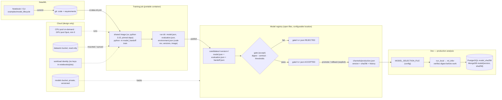

# Notebook-to-model delivery — design

[Task](README.md) · [Evidence](EVIDENCE.md)

## Workflow

Solid boxes run in this repository today. Dashed boxes are the cloud design and were not deployed.

## Training environment notes

| Concern | Local (implemented) | Cloud (design) |
|---|---|---|
| Environment | One shared image (`Dockerfile`, Python 3.15, `requirements-local.txt`). `environment.json` records code revision, Python, NumPy, platform and image. | The same image is pushed by digest to a registry. Jobs reference `image@sha256:…`, never `:latest`. |
| CPU/GPU | CPU only. `TRAINING_ACCELERATOR` is recorded. | A Kubernetes `Job` (AKS today) requests `cpu`/`memory`, or `nvidia.com/gpu: 1` on a GPU Spot pool that scales from 0. Notebooks run on a small CPU pool with idle shutdown. Only the node pools are provider-specific. |
| Dataset access | Synthetic data from a fixed seed. Identity is `dataset` + `seed` in the report. | Read-only, versioned dataset prefix (`datasets/<name>/<version>/`). Its identity goes into `evaluation.json` and the gate checks it. |
| Credentials | None. Local volumes. | Workload/managed identity scoped per job: read on datasets, write only on `models/*/candidates/`. Only the promotion identity (a CI environment with required reviewers) can write `channels/`. No keys in notebooks or images. |
| Artifact persistence | `data-model-registry` volume (`MODEL_REGISTRY_DIR`). | A private bucket/container with versioning. Candidate prefixes are write-once (immutability policy). Gate records and channels sit beside them. Lifecycle rules for images don't apply to models (Terraform task). |
| Job cleanup | Run dirs are scratch. Only `publish` copies into the registry. | `ttlSecondsAfterFinished`, `activeDeadlineSeconds`, `backoffLimit` and an emptyDir scratch volume. Failed or preempted jobs leave nothing in the registry because publication is a separate, atomic step. GPU pool returns to 0 nodes. |

## Handoff contract (`handoff.json`, schema `model-handoff-v1`)

| Field | Content |
|---|---|
| `model`, `version` | Release identity. The version is immutable: republishing the same version is refused. |
| `artifact.uri` / `path` | Location relative to the registry root. That keeps it portable between a host, a container and a bucket. |
| `artifact.sha256`, `size_bytes`, `format`, `media_type` | Expected digest of the open JSON artifact (`toy-linear-v1`). |
| `contract` | Loader (`examples.model_lifecycle.train:load_model`), input `(n, 2)` finite floats `[feature_a, feature_b]`, output `(n,)`. |
| `evaluation` | Report path and digest, dataset/seed, `test_mse`, `baseline_test_mse`. |
| `training` | Code revision, interpreter and NumPy versions, platform, image and accelerator. |

**Gate (`accept`)** — every check must pass before a candidate can be selected:
- digest matches `handoff.json`, and the producer's announced digest if one is given;
- the evaluation report's digest matches;
- the supplied loader accepts the artifact and the prediction shape contract holds;
- dataset identity matches;
- re-scored `test_mse` equals the reported value;
- `test_mse ≤ 0.001` and `test_mse ≤ 1%` of the baseline ([policy.json](../../model_handoff/policy.json)).

The result is recorded as `gate/<version>.json` (ACCEPTED or REJECTED, with each check).

## Promotion and rollback

- **Publish ≠ select.** `publish` never writes a channel. CI asserts this.
- **Promote** needs an ACCEPTED record, and the artifact must still hash to the accepted digest. It atomically rewrites `channels/production.json` with `version`, `sha256`, the relative artifact path and an appended history entry (who, when, why). In the cloud design, promotion runs from a protected CI environment that needs approval. That is the only identity with write access to `channels/`.
- **Rollback** re-selects the previous (or a named) version through the same checks, so a REJECTED or tampered version can't be rolled back to. Old candidates are kept; nothing is deleted.
- **Consumption** is configuration only. Dev's runner reads `MODEL_SELECTION_FILE`, verifies the bytes against the selected digest *before* processing, and passes `--expected-sha256` to `ml_infer`. The digest is stored in PostgreSQL rows and the MongoDB experiment document, and the API returns it. If the variable is unset, the original fixture weights are used. If it is set but broken, the run fails rather than falling back silently. Changing models needs no API rebuild. A promotion or rollback takes effect on the next analysis run. Changing the variable in Compose needs a container restart.

## Moving training/storage to another provider

| Changes | Doesn't change |
|---|---|
| Terraform storage module (bucket, versioning, immutability, lifecycle), node pools, identity bindings | Training image, `model_handoff` CLI, `handoff.json`/channel schemas, gate policy |
| The way the registry directory is materialized: a CSI/FUSE mount, or `rclone`/`azcopy`/`aws s3 sync` of `<model>/` into `MODEL_REGISTRY_DIR` before a job, and of the candidate prefix afterwards | Consumer code: it only reads a channel file and a relative path, then verifies SHA-256 |
| CI secrets replaced by OIDC federation to the new provider | Dev pipeline steps and the stored digests |

The steps are: copy candidates and channels with checksums, and run `resolve` plus the e2e verifier against the new location. Then switch `MODEL_REGISTRY_DIR`/`MODEL_SELECTION_FILE`. To roll back, point the configuration at the old location; both copies are immutable. No proprietary ML API (Azure ML, SageMaker, Vertex) is used anywhere in training or consumption.

## Ownership and CI

| Path | Owner | Workflow |
|---|---|---|
| `services/api/**` | Dev | `ci-core-dev.yml`: image build and unit tests |
| `pipelines/**`, `scripts/**`, `tests/e2e_verify.py`, `run-experiment.sh`, `verify-experiment.sh` | Dev | `ci-core-dev.yml`: unit tests, E2E with fixture model, consumer-compatibility E2E with a promoted toy model |
| `infra/**` | Dev | `ci-core-dev.yml`: `terraform fmt -check`, `init -backend=false`, `validate` |
| `examples/model_lifecycle/**` (notebook, training, evaluation), `tests/test_model_lifecycle.py` | Data/ML | `ci-data-ml.yml`: train, evaluate, publish, gate, negative control |
| Model-only candidate (no code change) | Data/ML | `ci-data-ml.yml` `workflow_dispatch` with `source_run_id` (+ `expected_sha256`): gate, publish and consumer contract only. No training, no API build, no selection |
| `model_handoff/**`, `examples/model_lifecycle/train.py` (loader used by the gate), `Dockerfile`, `requirements-local.txt` | Shared (DevOps/MLOps) | Both workflows |
| `compose.yaml`, `build.sh`, `start.sh`, `model-handoff.sh` | Shared runtime | `ci-core-dev.yml` (they only affect the running stack) |

## Limitations

- The registry is a local volume. Object-storage sync, the cloud job spec, identity and the approval environment are design only.
- The image-inference step is a mock. A passing pipeline proves selection and digest propagation, not model quality. Quality comes from the gate's re-evaluation with the supplied helpers.
- Training is deterministic, so versions 1.0.0 and 1.2.0 in the demo have identical bytes and digests. The rollback demo shows the selection mechanics, not a behavioural difference.
- The workflows were linted (actionlint) and their steps replayed locally. They have not run on GitHub Actions yet (see [EVIDENCE.md](EVIDENCE.md)).
